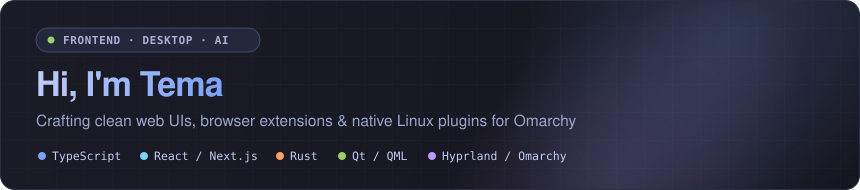
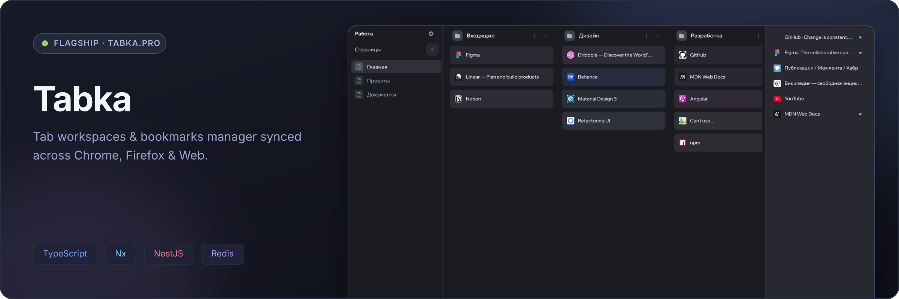
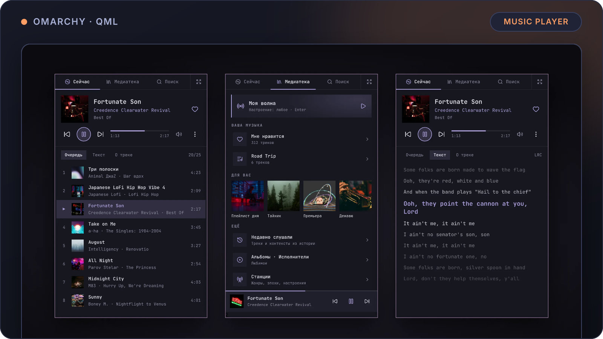
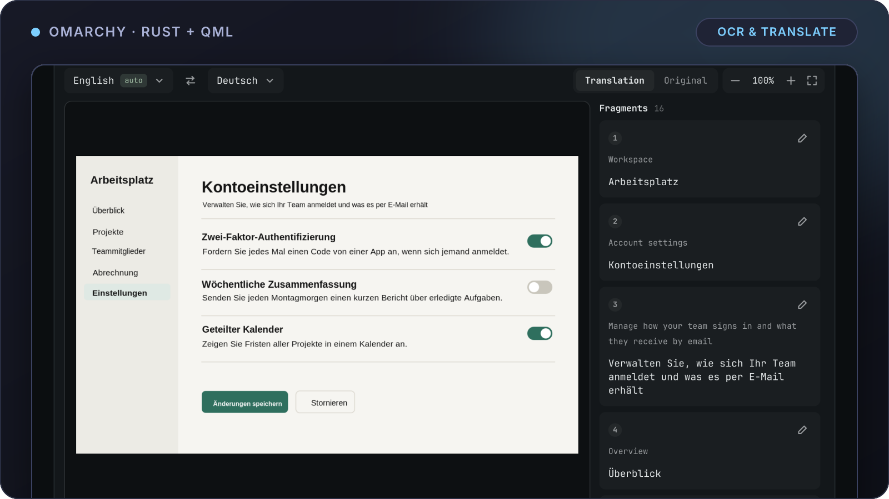
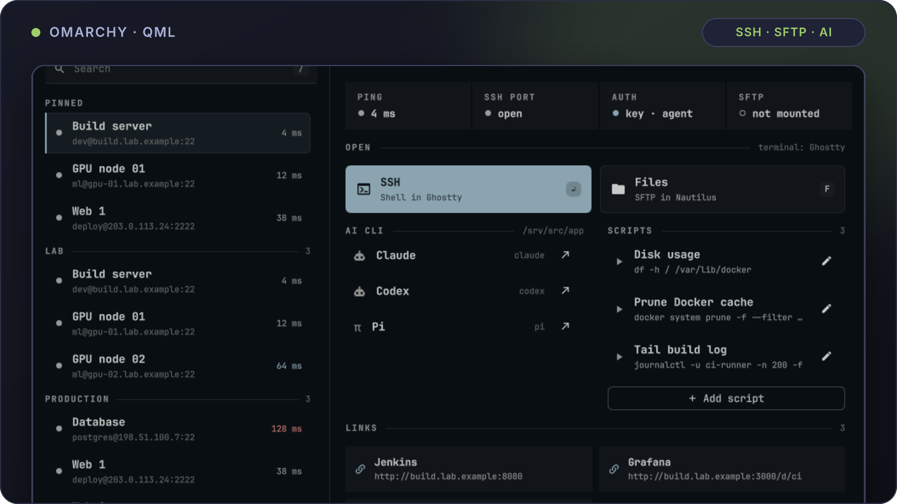
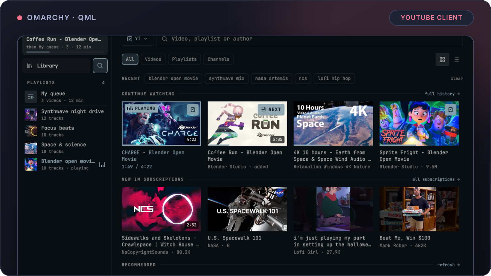
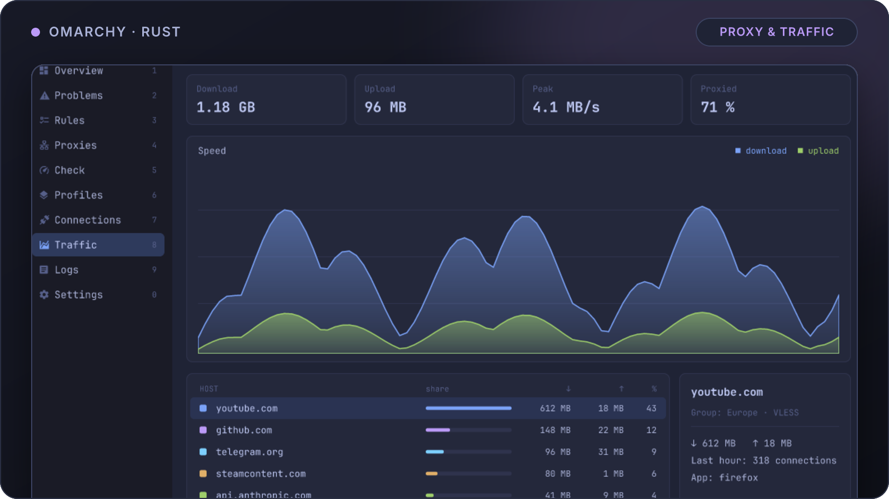
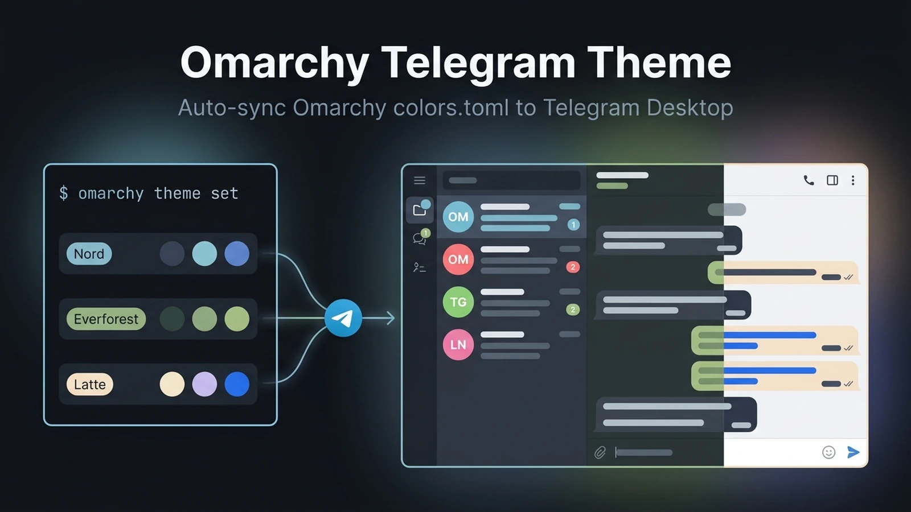
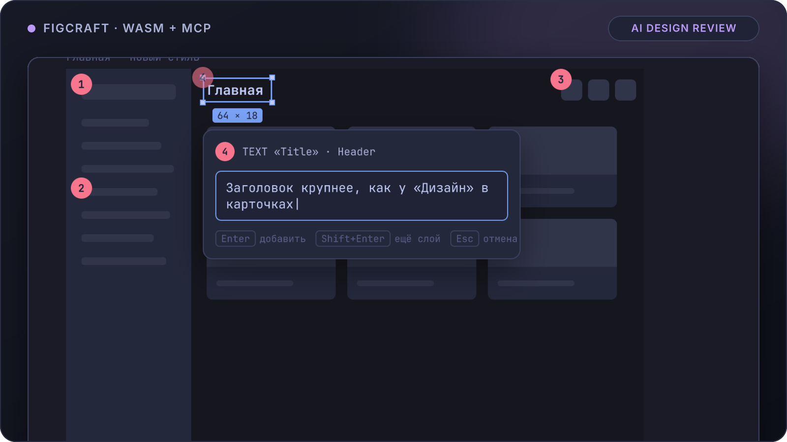
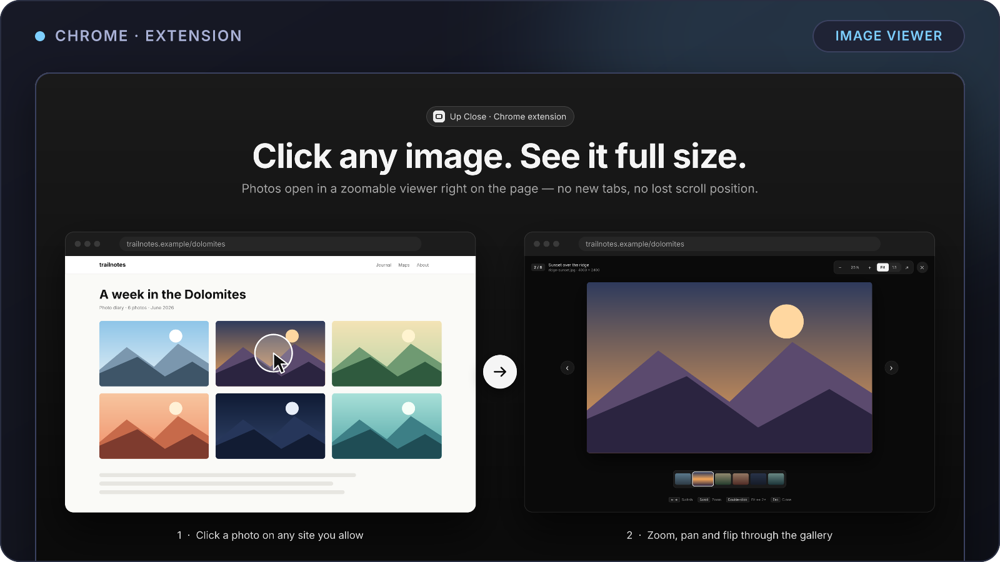

<picture>
  <source media="(prefers-color-scheme: dark)" srcset="./assets/banner-dark.svg">
  <source media="(prefers-color-scheme: light)" srcset="./assets/banner-light.svg">
  
</picture>

  
  
  

---

### Flagship Project

<table width="100%">
  <tr>
    <td>
      
      
<strong>Tabka</strong> — Browser extension &amp; web app for organizing tab workspaces and bookmarks across devices (<code>Nx</code> · <code>TypeScript</code> · <code>NestJS</code> · <code>Redis</code>).

      

        
        
        
        
      

    </td>
  </tr>
</table>

 

### Omarchy Ecosystem

<table width="100%">
  <tr>
    <td width="50%" valign="top">
      
      

        
        <a href="https://github.com/vornashev/omarchy-yandex-music"><strong>omarchy-yandex-music</strong></a>
      

      
Native browser-free Yandex Music mini-player for Omarchy Shell.

      
<code>QML</code> &nbsp;·&nbsp; <a href="https://plugins.omarchy.org/plugin.html?id=vornashev.yandex-music">Omarchy Store ↗</a>

    </td>
    <td width="50%" valign="top">
      
      

        
        <a href="https://github.com/vornashev/OmaTranslate"><strong>OmaTranslate</strong></a>
      

      
Instant translation for text, clipboard &amp; screenshots — 55 languages, OCR &amp; offline mode.

      
<code>Rust</code> &nbsp;·&nbsp; <code>QML</code> &nbsp;·&nbsp; <code>Wayland</code>

    </td>
  </tr>
  <tr>
    <td width="50%" valign="top">
      
      

        
        <a href="https://github.com/vornashev/omarchy-hostdeck"><strong>omarchy-hostdeck</strong></a>
      

      
Omarchy bar plugin for SSH, SFTP and remote AI CLI workflows.

      
<code>QML</code> &nbsp;·&nbsp; <a href="https://plugins.omarchy.org/plugin.html?id=vornashev.hostdeck">Omarchy Store ↗</a>

    </td>
    <td width="50%" valign="top">
      
      

        
        <a href="https://github.com/vornashev/OmaTube"><strong>OmaTube</strong></a>
      

      
Native YouTube and YouTube Music plugin for Omarchy.

      
<code>QML</code> &nbsp;·&nbsp; <a href="https://plugins.omarchy.org/plugin.html?id=vornashev.omatube">Omarchy Store ↗</a>

    </td>
  </tr>
  <tr>
    <td width="50%" valign="top">
      
      

        
        <a href="https://github.com/vornashev/omarchy-mihomo"><strong>omarchy-mihomo</strong></a>
      

      
Mihomo proxy rules, failing-site autofix &amp; live traffic stats right in the bar.

      
<code>Rust</code> &nbsp;·&nbsp; <code>Omarchy</code>

    </td>
    <td width="50%" valign="top">
      
      

        
        <a href="https://github.com/vornashev/omarchy-telegram-theme"><strong>omarchy-telegram-theme</strong></a>
      

      
Automatic Telegram Desktop themes generated from Omarchy palettes.

      
<code>Python</code> &nbsp;·&nbsp; <code>Omarchy</code>

    </td>
  </tr>
</table>

 

### Tools, Extensions & AI

<table width="100%">
  <tr>
    <td width="50%" valign="top">
      
      

        
        <a href="https://github.com/vornashev/figcraft-review"><strong>figcraft-review</strong></a>
      

      
AI-first design review plugin for FigCraft — annotate layers and edit designs via Claude Code or Codex.

      
<code>WASM</code> &nbsp;·&nbsp; <code>MCP</code> &nbsp;·&nbsp; <code>AI Agents</code>

    </td>
    <td width="50%" valign="top">
      
      

        
        <a href="https://github.com/vornashev/up-close"><strong>up-close</strong></a>
      

      
Click any image on allowlisted sites for a zoomable in-page image viewer.

      
<code>JavaScript</code> &nbsp;·&nbsp; <code>Chrome Extension</code>

    </td>
  </tr>
</table>

  
Archive &amp; DSH

   
  <ul>
    <li><a href="https://github.com/vornashev/dsh-ui-enhancements"><strong>dsh-ui-enhancements</strong></a> — DSH profile bundle for Web GUI display preferences (<code>TypeScript</code>)</li>
    <li><a href="https://github.com/vornashev/dsh-simple-git"><strong>dsh-simple-git</strong></a> — Simple Git integration for DSH (<code>JavaScript</code>)</li>
  </ul>

 

### Tech Stack

**Core · Frontend**

**Beyond Frontend · Backend, Desktop & AI**

 

### GitHub Activity

<table width="100%">
  <tr>
    <td width="50%" align="center">
      
    </td>
    <td width="50%" align="center">
      
    </td>
  </tr>
</table>
